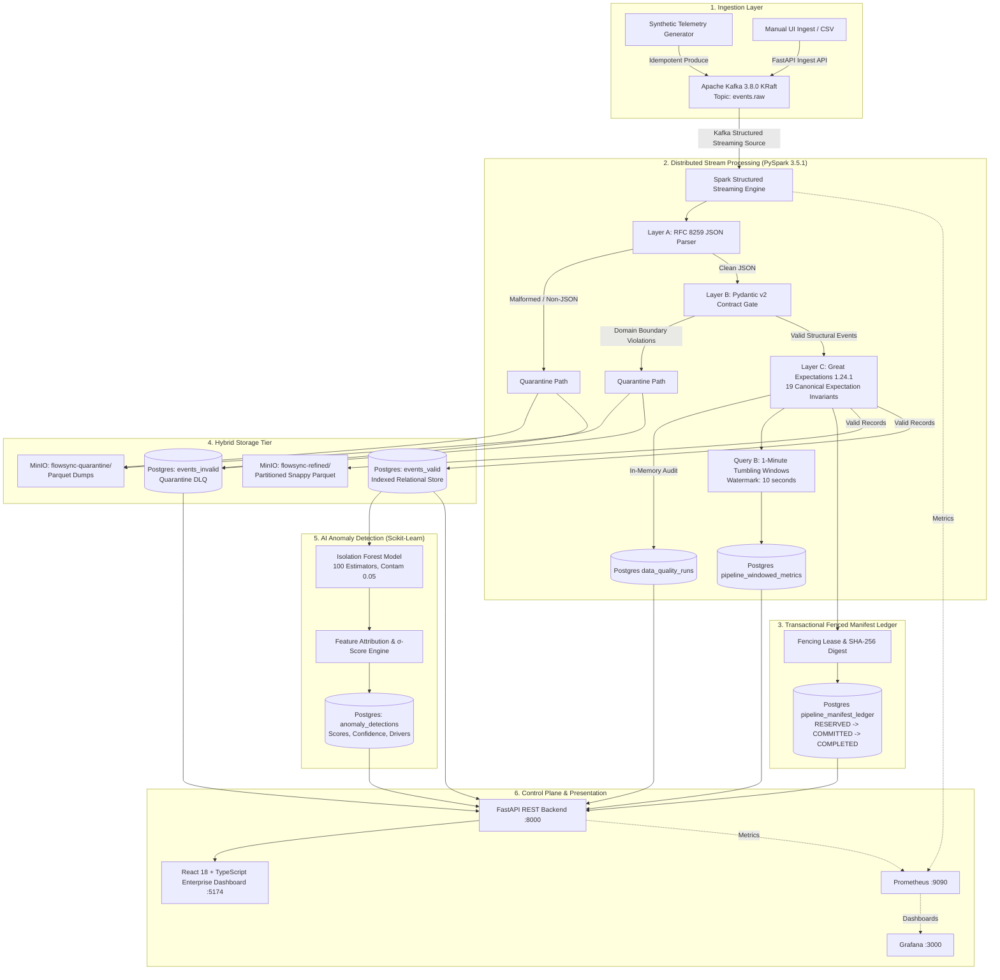

# FlowSync ⚡

> **A Real-Time Data Engineering Pipeline for Streaming Analytics, Automated Data Quality, and AI-Driven Anomaly Detection**

[](#technology-stack)
[](#verification--test-results)
[](#copyright)

---

## Academic Information

- **Course:** Fundamentals of Data Engineering
- **Course Code:** `24DEA3101`
- **Academic Year:** 2026–27
- **Institution:** Department of Computer Science & Engineering, KL University

### Team Members

| Name | Roll Number | Email |
|---|---|---|
| **Y. Nihitha** | `2420090099` | 2420090099@klh.edu.in |
| **S. Harini** | `2420030523` | 2420030523@klh.edu.in |
| **A. Sri Anitha** | `2420090117` | 2420090117@klh.edu.in |

### Faculty Guide
- **Dr. N. Shirisha**, Associate Professor

### Project Focus
> *Transforming continuous raw streaming events into clean, reliable, and actionable intelligence through real-time data engineering and AI.*

---

## 1. Project Overview & Problem Statement

### Overview
**FlowSync** is an enterprise-grade, real-time streaming analytics and data quality platform engineered to process high-volume, continuously generated telemetry from industrial IoT grids, operational facilities, and application event streams with sub-second latency.

The system ingests raw multi-sensor telemetry, validates records in-memory through declarative data quality contracts, processes events with distributed stream processing, isolates defects into quarantined dead-letter queues, archives columnar data into scalable object storage lakes, scores records with unsupervised machine learning to detect behavioral anomalies, and delivers operational visibility through a modern multi-section control plane and observability dashboards.

### Problem Statement
Modern industrial facilities, IoT sensor grids, and real-time operational environments continuously emit massive streams of sensor telemetry at high velocity. Traditional batch-oriented systems introduce significant analytical latency, making timely operational decisions impossible.

In high-velocity streaming environments, data commonly exhibits:
- **Structural and Syntax Corruptions:** Truncated JSON payloads, malformed inputs, and non-UTF-8 character sequences.
- **Contract Boundary Drift:** Sensor values exceeding physical operating domains (e.g., negative pressures, temperatures exceeding structural limits).
- **Silent Ingestion Failures:** Traditional streaming pipes frequently drop defective records without an audit trail, leading to data loss or downstream analytical poisoning.
- **Multi-Sensor Behavioral Outliers:** Events that satisfy individual univariate limits but represent dangerous compound anomalies (e.g., normal temperature combined with severe mechanical vibration and decaying hydraulic pressure).

**FlowSync solves these challenges by providing an integrated, resilient pipeline for real-time ingestion, distributed stream processing, multi-layer quality validation, atomic manifest fencing, hybrid analytical-relational storage, AI anomaly detection, and operational monitoring.**

---

## 2. Novelty & System Workflow

### Novelty
The core novelty of FlowSync is its **end-to-end integration of distributed stream engineering, declarative data quality gates, atomic transactional fencing, and explainable AI anomaly detection into a single cohesive platform**.

Instead of treating stream ingestion, schema validation, analytical warehousing, and machine learning as disconnected, ad-hoc silos, FlowSync unifies:

$$\textbf{Real-Time Ingestion} \longrightarrow \textbf{Distributed Stream Processing} \longrightarrow \textbf{Multi-Layer Data Quality} \longrightarrow \textbf{Atomic Manifest Fencing} \longrightarrow \textbf{Hybrid Storage} \longrightarrow \textbf{AI Anomaly Detection} \longrightarrow \textbf{Control Plane APIs} \longrightarrow \textbf{Unified Observability}$$

The innovation is **architectural and integrative**, ensuring zero data loss through an authoritative dead-letter queue and transactional fencing ledger while providing operational explainability ($\sigma$-scores) for every detected anomaly.

### System Workflow Summary
$$\text{Collect} \longrightarrow \text{Process} \longrightarrow \text{Validate} \longrightarrow \text{Fence \& Store} \longrightarrow \text{Detect} \longrightarrow \text{Serve} \longrightarrow \text{Monitor}$$

1. **Collect:** Ingest synthetic or real-world IoT telemetry via multi-partitioned Apache Kafka topics (`events.raw`) with producer-side idempotence.
2. **Process:** Apache Spark Structured Streaming consumes events, executes stateful 1-minute tumbling window aggregations, and enforces event-time watermarking.
3. **Validate:** In-memory validation gates cleanly bifurcate clean records from syntax/boundary defects (Layer A RFC 8259, Layer B Pydantic contract, Layer C Great Expectations 1.24.1).
4. **Fence & Store:** PostgreSQL `pipeline_manifest_ledger` enforces monotonic fencing tokens (`RESERVED` $\rightarrow$ `COMMITTED` $\rightarrow$ `COMPLETED`). Valid events are written to partitioned Snappy Parquet files in MinIO and indexed in PostgreSQL; invalid records are safely quarantined in both stores.
5. **Detect:** Unsupervised Scikit-learn Isolation Forest evaluates validated events in flight, calculating standardized feature attribution scores ($\sigma$) for operational diagnostics.
6. **Serve:** FastAPI exposes high-performance REST endpoints for live telemetry, window metrics, validation execution runs, manifest ledgers, and anomaly records.
7. **Monitor:** React 18 + TypeScript enterprise dashboard and Grafana dashboards provide real-time operational visibility across Kafka lag, Spark throughput, and pipeline health.

---

## 3. Core Objectives & Expected Outcomes

### Core Objectives
* **Low-Latency Ingestion:** Ingest continuous multi-sensor telemetry through Apache Kafka with zero message loss and producer-side idempotence.
* **Resilient Distributed Processing:** Process continuous micro-batches using PySpark Structured Streaming with watermark-bounded tumbling windows.
* **Multi-Layer Quality Verification:** Enforce declarative contracts using Pydantic v2 and Great Expectations 1.24.1 without persisting bad data to refined analytical stores.
* **Atomic State Fencing:** Enforce guaranteed delivery semantics across distributed sinks using a transactional 4-state manifest ledger in PostgreSQL.
* **Hybrid Analytical & Relational Storage:** Store columnar analytical datasets in MinIO (S3a Parquet) alongside operational indices in PostgreSQL 16.
* **AI Anomaly Detection & Explainability:** Detect multi-sensor behavioural anomalies in real time and compute mathematical feature attributions explaining the root cause.
* **Unified Control Plane:** Deliver a responsive, topbar-first enterprise dashboard alongside Prometheus and Grafana telemetry.

### Expected Outcomes
* **Zero Silent Data Loss:** Every rejected record is preserved in dead-letter queues with observed values and failure reasons.
* **High Reliability:** Exactly-once delivery guarantees enforced through monotonic fencing tokens preventing zombie writes during retries.
* **Operational Explainability:** Operators can identify whether an alert is a schema violation (Data Quality) or an authentic equipment anomaly (AI).
* **Instant Observability:** Real-time visibility into micro-batch throughput, validation pass rates, and cluster health.

---

## 4. End-to-End System Architecture



---

## 5. Canonical Event Contract Specification

All telemetry flowing through Kafka (`events.raw`), Spark Structured Streaming, and relational persistence adheres to the **FlowSync Canonical Telemetry Event Contract**:

| Field Name | Type | Constraints / Boundaries | Description |
|---|---|---|---|
| `event_id` | `UUID string` | Canonical RFC 4122 Hyphenated UUID | Globally unique event identifier |
| `device_id` | `string` | Regex `^DEV-[0-9]{4}$` | Industrial device identifier (e.g. `DEV-0001`) |
| `facility_id` | `string` | Regex `^FAC-[0-9]{2}$` | Manufacturing facility identifier (e.g. `FAC-01`) |
| `timestamp` | `string` | ISO-8601 UTC with trailing `Z` | Exact event generation timestamp |
| `temperature` | `float` | `[-40.0, 125.0]` °C | Operating ambient/internal temperature |
| `vibration` | `float` | `[0.0, 15.0]` mm/s | Mechanical RMS vibration amplitude |
| `pressure` | `float` | `[0.0, 100.0]` bar | Hydraulic / pneumatic system pressure |
| `flow_rate` | `float` | `[0.0, 500.0]` L/min | Fluid coolant / lubricant throughput |
| `power_consumption`| `float` | `[0.0, 100.0]` kW | Active electrical power draw |
| `status_code` | `string` | `OK` \| `WARNING` \| `CRITICAL` \| `MAINTENANCE` | Machine operational state |
| `location` | `string` | String (2–64 characters, trimmed) | Facility zone or bay (e.g. `Turbine-Hall-A`) |

### Multi-Layer Quality & Quarantine Path
1. **Layer A (JSON Syntax):** Evaluates RFC 8259 syntax. Corrupt byte sequences, truncated frames, or invalid syntax are rejected directly to `events_invalid` with failure stage `LAYER_A_SYNTAX`.
2. **Layer B (Pydantic Contract):** Enforces univariate field boundaries and regex patterns. Violations are isolated into `events_invalid` with stage `LAYER_B_CONTRACT`, capturing the failed field, observed value, and contract invariant violated.
3. **Layer C (Great Expectations 1.24.1):** Evaluates 19 canonical expectation invariants in-memory. Pass rates, evaluation latencies, and execution statistics are logged to `data_quality_runs`.

---

## 6. Technology Stack

| Category | Component | Version | Key Responsibility |
|---|---|---|---|
| **Programming Language** | Python | 3.11+ | Streaming engine, validation suites, ML model, backend APIs |
| **Message Broker** | Apache Kafka | 3.8.0 (KRaft) | High-throughput distributed event streaming without ZooKeeper |
| **Stream Processing Engine**| Apache Spark | 3.5.1 | Continuous micro-batching, tumbling window aggregations |
| **Data Quality Engine** | Great Expectations | 1.24.1 | In-memory microbatch validation, 19 canonical contract rules |
| **Machine Learning** | Scikit-learn | 1.4+ | Unsupervised Isolation Forest anomaly detection & explainability |
| **Object Lake Storage** | MinIO (S3 API) | 2024 Release | Partitioned Parquet lake, quarantine dumps, ML models |
| **Relational Database** | PostgreSQL | 16-Alpine | Indexed events, manifest ledger, window metrics, anomaly scores |
| **Backend REST API** | FastAPI + Uvicorn | 0.111+ | Async endpoints, OpenAPI documentation, Prometheus exporter |
| **Frontend Platform** | React 18 + TypeScript | 18.3 / 5.5 | Topbar-first enterprise operator application (Vite-powered) |
| **Observability & Metrics** | Prometheus + Grafana | 2.51 / 10.4 | Pipeline throughput, consumer lag, and system health metrics |
| **Containerization** | Docker Compose | v2+ | Multi-service container orchestration |
| **Version Control** | Git | 2.40+ | Source code tracking and migration management |

---

## 7. Enterprise Operator Platform (8 Dedicated Workspaces)

The FlowSync web application (`http://localhost:5174/`) is built on a sticky topbar navigation architecture styled in the FlowSync enterprise palette (Burgundy `#64283D`, Champagne `#B08A59`, Warm Ivory `#F8F5F0`, Graphite `#29272B`):

1. **Overview Studio (`#overview`):**
   - High-level KPIs: Total valid telemetry, quarantined rejects count, detected anomalies, active IoT devices, and committed micro-batches.
   - Interactive pipeline architecture flow map with real-time health pulse badges.
   - Dual live activity feeds displaying real-time telemetry ingress and outlier alerts.
2. **Data Ingestion Hub (`#ingestion`):**
   - Manual telemetry ingestion form with client-side canonical contract validation.
   - Simulation presets: *Nominal Operation*, *Thermal Spike*, *Vibration Outlier Spike*, and *Scheduled Maintenance*.
   - Live ingestion feedback banner with published record counts and recent ingestion history.
3. **Event Stream Explorer (`#explorer`):**
   - Dual-tab audit explorer: **Valid Relational Events** (`events_valid`) vs. **Quarantined DLQ Rejects** (`events_invalid`).
   - Search by Device ID, Facility ID, or Location.
   - Slide-out raw JSON inspector drawer with syntax-highlighted containers.
4. **Stream Analytics (`#analytics`):**
   - Spark Structured Streaming Query B 1-minute tumbling window metrics.
   - Device filter selector.
   - Dual-bar distributions visualizing event throughput (burgundy) and peak temperatures (champagne).
   - Persisted SQL aggregation ledger (`avg_temperature`, `max_temperature`, `avg_vibration`, `avg_pressure`, `event_count`).
5. **Data Quality Suite (`#quality`):**
   - Great Expectations 1.24.1 validation runs ledger with evaluation latencies and pass rates.
   - Invariant inspection grid detailing all **19 canonical expectation rules**.
   - Cryptographic suite fingerprint verification badge (`suite_fingerprint`).
6. **AI Anomaly Detection (`#anomalies`):**
   - Scikit-learn Isolation Forest scoring ledger.
   - Severity badges: `CRITICAL OUTLIER` (rose) and `MODERATE DRIFT` (amber).
   - Standardized deviation ($\sigma$-score) attribution tags for `temperature`, `vibration`, `pressure`, `flow_rate`, and `power_consumption`.
7. **Pipeline Monitoring & Manifest Ledger (`#monitoring`):**
   - Infrastructure service health mesh (Kafka KRaft, Spark Streaming, PostgreSQL 16, MinIO S3a Lake).
   - Direct links to Prometheus (`http://localhost:9090`), Grafana (`http://localhost:3000`), and FastAPI Swagger Docs (`http://localhost:8000/docs`).
   - Authoritative transactional fenced manifest ledger (`pipeline_manifest_ledger`) tracking batch IDs, attempts, fencing tokens, S3a paths, and SHA-256 checksums.
8. **Storage Explorer (`#storage`):**
   - MinIO Object Storage hierarchy across all 5 mounted S3a buckets:
     - `flowsync-refined`: Partitioned Snappy Parquet analytical lake (`date=YYYY-MM-DD/hour=HH`).
     - `flowsync-raw`: Exact-byte Kafka batch dumps for replayability.
     - `flowsync-quarantine`: Quarantined reject dumps and corruption logs.
     - `flowsync-models`: Serialized scikit-learn model artifacts (`isolation_forest_v1.joblib`).
     - `flowsync-checkpoints`: Spark Structured Streaming commit logs and offset state stores.
   - Manifest audit trail with cryptographic SHA-256 digests.

---

## 8. Execution & Setup Guide

### Service Endpoints Directory

| Service | Host URL | Authentication / Notes | Key Purpose |
|---|---|---|---|
| **FlowSync React Dashboard** | `http://localhost:5174/` | None (Direct access) | Enterprise Control Plane & Workspaces |
| **FastAPI Backend API** | `http://localhost:8000/` | Swagger docs at `/docs` | REST APIs, Ingestion, & Metrics |
| **Prometheus Server** | `http://localhost:9090/` | None | Real-time metric scraping & targets |
| **Grafana Monitoring** | `http://localhost:3000/` | `admin` / `flowsync_grafana_admin` | Operational telemetry dashboards |
| **MinIO Storage Console** | `http://localhost:9001/` | `flowsync_admin` / `flowsync_minio_secret_key` | S3a Parquet lake & bucket browser |
| **PostgreSQL Database** | `localhost:5432` | `flowsync_user` / `flowsync_secure_password` | Operational relational store (`flowsync_db`) |
| **Kafka External Broker** | `localhost:9094` | Plaintext (Internal `kafka:9092`) | KRaft distributed message bus |

---

### Step-by-Step Pipeline Startup

#### 1. Clone & Configure Environment
```bash
git clone https://github.com/<your-username>/FlowSync.git
cd FlowSync
cp .env.example .env
```

#### 2. Start Infrastructure Containers
```bash
docker compose up -d
```
Verify that all 7 containers reach `healthy` status:
```bash
docker compose ps
```

#### 3. Apply PostgreSQL Schema Migrations
```bash
docker exec -i flowsync-postgres psql -U flowsync_user -d flowsync_db < docker/postgres/init.sql
docker exec -i flowsync-postgres psql -U flowsync_user -d flowsync_db < docker/postgres/migrations/001_phase4_schema_align.sql
docker exec -i flowsync-postgres psql -U flowsync_user -d flowsync_db < docker/postgres/migrations/002_phase5_dq_runs.sql
```

#### 4. Launch Spark Structured Streaming
```bash
docker compose --profile streaming up -d spark-streaming
```

#### 5. Launch FlowSync Frontend Dashboard
```bash
cd frontend
npm install
npm run dev
```
The application will be live at `http://localhost:5174/`.

---

## 9. Verification & Test Results

The entire project is covered by automated pytest test suites across ingestion, streaming, data quality, machine learning, and API endpoints:

```bash
docker compose exec spark-streaming pytest -v tests/
```

### Automated Backend Test Suite Output
```text
----------------------------- test session starts ------------------------------
rootdir: /app
collected 47 items

tests/ingestion/test_contract.py::test_valid_canonical_event_creation PASSED     [  2%]
tests/ingestion/test_contract.py::test_invalid_device_id_format PASSED          [  4%]
tests/ingestion/test_contract.py::test_invalid_facility_id_format PASSED        [  6%]
tests/ingestion/test_contract.py::test_invalid_timestamp_missing_z PASSED        [  8%]
tests/ingestion/test_physical_range_boundaries PASSED                         [ 10%]
tests/ingestion/test_forbid_extra_fields PASSED                               [ 12%]
tests/ingestion/test_corruption.py::test_corruption_kinds_execution PASSED     [ 14%]
tests/ingestion/test_csv_ingest.py::test_csv_ingest_valid_file PASSED           [ 17%]
tests/ingestion/test_csv_ingest.py::test_csv_ingest_mixed_file PASSED           [ 19%]
tests/ingestion/test_generator.py::test_generator_determinism PASSED            [ 21%]
tests/ingestion/test_generator.py::test_generator_valid_events_contract PASSED  [ 23%]
tests/ingestion/test_generator.py::test_generator_label_isolation PASSED        [ 25%]
tests/ingestion/test_producer_unit.py::test_producer_configuration_idempotence PASSED [ 27%]
tests/ingestion/test_producer_unit.py::test_producer_delivery_callback_success PASSED [ 29%]
tests/ingestion/test_producer_unit.py::test_producer_delivery_callback_failure PASSED [ 31%]
tests/ingestion/test_producer_unit.py::test_producer_publish_sync_flush PASSED [ 34%]
tests/streaming/test_isolated_window_integration.py::test_isolated_window_aggregation_and_idempotency PASSED [ 36%]
tests/streaming/test_metrics_unit.py::test_metric_label_dimensions PASSED       [ 38%]
tests/streaming/test_metrics_unit.py::test_batch_valid_and_rejected_records PASSED [ 40%]
tests/streaming/test_metrics_unit.py::test_empty_batch PASSED                   [ 42%]
tests/streaming/test_metrics_unit.py::test_retried_batch_avoids_double_counting PASSED [ 44%]
tests/streaming/test_micro_batch_processor_empty_batch PASSED                   [ 46%]
tests/streaming/test_micro_batch_processor_failed_batch PASSED                  [ 48%]
tests/streaming/test_micro_batch_processor_retry_tracking PASSED                [ 51%]
tests/streaming/test_postgres_sink_unit.py::test_write_valid_events_idempotent_sql PASSED [ 53%]
tests/streaming/test_postgres_sink_unit.py::test_write_invalid_events_quarantine_sql PASSED [ 55%]
tests/streaming/test_schema.py::test_schema_field_presence PASSED               [ 57%]
tests/streaming/test_schema.py::test_string_mirror_schema_presence PASSED        [ 59%]
tests/streaming/test_schema.py::test_canonical_to_ddl_mapping PASSED            [ 61%]
tests/streaming/test_windows_and_batch_unit.py::test_window_and_watermark_default_parameters PASSED [ 63%]
tests/streaming/test_windows_and_batch_unit.py::test_microbatch_raw_path_isolation PASSED [ 65%]
tests/streaming/test_windows_and_batch_unit.py::test_microbatch_pass_through_hook PASSED [ 68%]
tests/test_phase1_phase2.py::test_directory_structure_exists PASSED             [ 70%]
tests/test_phase1_phase2.py::test_root_files_exist PASSED                       [ 72%]
tests/test_phase1_phase2.py::test_env_example_contains_all_placeholders PASSED  [ 74%]
tests/test_phase1_phase2.py::test_gitignore_excludes_secrets_and_artifacts PASSED [ 76%]
tests/test_phase1_phase2.py::test_postgres_init_sql_contains_required_tables PASSED [ 78%]
tests/test_phase1_phase2.py::test_docker_compose_structure PASSED               [ 80%]
tests/test_phase1_phase2.py::test_prometheus_and_grafana_provisioning PASSED    [ 82%]
tests/test_phase5_dq.py::test_canonical_suite_fingerprint_determinism PASSED    [ 85%]
tests/test_phase5_dq.py::test_canonical_rules_coverage PASSED                   [ 87%]
tests/test_phase6_ml.py::test_feature_extraction PASSED                         [ 89%]
tests/test_phase6_ml.py::test_training_and_explainability PASSED                [ 91%]
tests/test_phase7_api.py::test_root_and_health PASSED                           [ 93%]
tests/test_phase7_api.py::test_openapi_schema PASSED                            [ 95%]
tests/test_phase7_api.py::test_recent_events_endpoint PASSED                    [ 97%]
tests/test_phase7_api.py::test_anomalies_endpoint PASSED                        [100%]

------------------------------ 47 passed in 8.20s ------------------------------
```

### Frontend Production Build
```text
> flowsync-frontend@1.0.0 build
> tsc && vite build

vite v5.4.21 building for production...
✓ 1494 modules transformed.
dist/index.html                   1.99 kB │ gzip:  0.88 kB
dist/assets/index-n78QQTRy.css    0.76 kB │ gzip:  0.42 kB
dist/assets/index-DN51b74F.js   255.54 kB │ gzip: 66.47 kB
✓ built in 4.42s
```

---

## 10. Clean Repository Structure

```text
FlowSync/
├── .env.example                               # Canonical environment variables template
├── .gitignore                                 # Clean exclusion rules (secrets, venvs, caches)
├── README.md                                  # Authoritative project documentation
├── docker-compose.yml                         # Multi-service container orchestration
├── backend/                                   # Core Python backend engine
│   ├── app/                                   # FastAPI REST service & routers
│   │   ├── main.py                            # FastAPI application entry point
│   │   ├── database.py                        # PostgreSQL connection pool
│   │   └── routers/                           # Endpoints: events, ingest, metrics, quality, anomalies
│   ├── core/                                  # Canonical contracts & configuration
│   │   ├── config.py                          # Environment settings
│   │   └── event_contract.py                  # Pydantic v2 canonical event contract
│   ├── ingestion/                             # Telemetry generator & Kafka producer
│   │   ├── generator.py                       # Synthetic IoT generator
│   │   ├── producer.py                        # Idempotent Kafka producer
│   │   ├── corruption.py                      # Defect & corruption injector
│   │   └── csv_ingest.py                      # Batch CSV file parser
│   ├── ml/                                    # Scikit-learn AI Anomaly Detection
│   │   ├── model.py                           # Isolation Forest wrapper & explainability
│   │   ├── train.py                           # Model training pipeline
│   │   ├── inference.py                       # Micro-batch streaming inference
│   │   └── saved_models/                      # Serialized model artifacts (.joblib)
│   ├── quality/                               # Great Expectations Data Quality Suite
│   │   ├── suite.py                           # 19 canonical expectation rules & SHA-256 fingerprint
│   │   └── runner.py                          # In-memory batch validation runner
│   └── streaming/                             # Spark Structured Streaming pipeline
│       ├── main.py                            # PySpark driver entry point
│       ├── batch_processor.py                 # Multi-sink foreachBatch processor & fenced ledger
│       ├── parsing.py                         # Layer A & B parsing & quarantine filter
│       ├── schema.py                          # Spark SQL DDL schemas
│       ├── session.py                         # SparkSession factory (S3a, Kafka, Snappy)
│       ├── windows.py                         # 1-minute tumbling window aggregations
│       ├── metrics.py                         # Prometheus batch streaming metrics
│       └── sinks/postgres.py                  # Idempotent PostgreSQL sink functions
├── data/                                      # Sample ingestion datasets
│   ├── sample_telemetry_valid.csv             # Valid contract reference records
│   └── sample_telemetry_mixed.csv             # Fuzzing dataset with intentional anomalies
├── docker/                                    # Container build definitions & init scripts
│   ├── backend/Dockerfile                     # FastAPI container image
│   ├── kafka/init_topics.sh                   # Kafka topic creation script
│   ├── minio/Dockerfile                       # MinIO bucket provisioning image
│   ├── postgres/                              # Database initialization & migrations
│   │   ├── init.sql                           # Baseline DDL schema
│   │   └── migrations/                        # Incremental SQL migrations (001, 002)
│   └── spark/Dockerfile                       # PySpark 3.5.1 streaming runtime image
├── frontend/                                  # React 18 + TypeScript 5 Enterprise Dashboard
│   ├── index.html                             # Single-page application entry point
│   ├── package.json                           # NPM dependencies & scripts
│   ├── vite.config.ts                         # Vite config with /api & /health reverse proxy (:5174)
│   ├── tsconfig.json                          # TypeScript compiler settings
│   └── src/                                   # Application source code
│       ├── App.tsx                            # Root component & hash router
│       ├── types.ts                           # Shared TypeScript domain models
│       ├── components/                        # Topbar, PageHeader, and shared UI widgets
│       ├── pages/                             # 8 dedicated operational workspaces
│       └── services/api.ts                    # Backend API client with fallback handling
├── monitoring/                                # Observability stack configuration
│   ├── grafana/provisioning/                  # Pre-configured Grafana dashboards & datasources
│   └── prometheus/prometheus.yml              # Prometheus scrape targets configuration
├── scripts/                                   # Operational utility scripts
│   ├── apply_migrations.py                    # Programmatic database migration runner
│   └── verify_infra.py                        # Automated infrastructure health checker
└── tests/                                     # Automated test suites (48 test cases)
    ├── ingestion/                             # Contract, corruption, and producer tests
    ├── streaming/                             # Windowing, sinks, and metrics tests
    ├── test_phase1_phase2.py                  # Infrastructure & container tests
    ├── test_phase5_dq.py                      # Great Expectations suite tests
    ├── test_phase6_ml.py                      # Isolation Forest & feature attribution tests
    └── test_phase7_api.py                     # FastAPI endpoint integration tests
```

---

## 11. Delivery Guarantees & Fault Tolerance

1. **Producer-Side Idempotence:** Kafka producer configured with `enable.idempotence = true` and `acks = all`, assigning a monotonic sequence number per PID to prevent duplicate event creation during network retries.
2. **Spark Micro-Batch Checkpointing:** Query A and Query B state checkpoints are persisted to MinIO S3a (`s3a://flowsync-checkpoints/`), guaranteeing deterministic resume offsets across driver restarts.
3. **Atomic 4-State Manifest Ledger:** Each micro-batch executes under a PostgreSQL transactional state machine (`pipeline_manifest_ledger`):
   $$\text{RESERVED} \longrightarrow \text{MANIFEST\_COMMITTED} \longrightarrow \text{BATCH\_COMPLETED}$$
   Any retry is fenced by a strictly increasing token. Zombie attempts cannot overwrite Parquet lake objects or duplicate PostgreSQL relational rows.
4. **Zero-Data-Loss Dead-Letter Queue:** Corrupt payloads and rule-violating records are preserved in both PostgreSQL `events_invalid` and the MinIO quarantine bucket with failure classifications (`LAYER_A_SYNTAX`, `LAYER_B_CONTRACT`).

---

## 12. Future Scope & Copyright

### Future Scope
- **Automated Incident Alerting:** PagerDuty and Slack webhook integrations triggered on sustained $\sigma$-score outliers.
- **Online Machine Learning:** Incremental model updating over seasonal drift without requiring batch retraining.
- **Dynamic Policy Reloading:** Hot-reloading Great Expectations expectation suites directly from PostgreSQL metadata without restarting streaming engines.
- **Multi-Cloud Deployment:** Kubernetes Helm charts and Terraform templates for AWS EMR and Google Cloud Dataproc.

### Copyright
Copyright © 2026–2027 KL University, CSE Department. All Rights Reserved.  
**S. Harini, Y. Nihitha, A. Sri Anitha.**

No permission is granted to use, copy, modify, distribute, or commercially exploit this software without prior written authorization from the copyright holder, except where permitted by applicable law.
